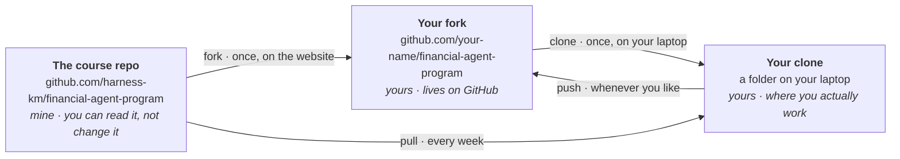

# GitHub, for people who have never used it

You need GitHub for three things on this course: to get each week's material, to keep your own
work safe, and to post what you built. That is all. You are not expected to arrive knowing any
of this.

Every step below says what you are doing and why. The why matters more than the commands — the
commands are four lines you will copy twice and then stop thinking about, but if the picture in
your head is wrong, everything git says to you afterwards sounds like nonsense.

Budget forty minutes for the first time through. We also do all of it together in the setup
session, so if you would rather wait and follow along, that is a perfectly good plan.

## Git and GitHub are two different things

This trips up almost everyone, so let's get it out of the way.

**Git** is a program on your computer that tracks changes to files. It has nothing to do with the
internet. It was written in 2005 by the person who wrote Linux, in about two weeks, and it shows:
it is enormously powerful and its error messages read like they were translated from another
language by someone in a hurry. You will use perhaps six of its commands.

**GitHub** is a website that stores copies of git projects so people can share them. Git works
fine without it. GitHub is where this course lives.

So: git is the tool, GitHub is the place. When something goes wrong it is almost always git
talking, not GitHub.

## The three copies

Here is the picture to keep in your head. There will be **three copies** of this course, and
knowing which is which explains every command in this guide.



Read it as: I publish to the course repo. You take a copy of it on GitHub, which is called a
**fork**. You download your fork onto your laptop, which is called a **clone**. You work in the
clone. Once a week you pull my new material down into it.

The two arrows pointing at your clone are the whole relationship. One brings my work to you, the
other sends your work up to your own backup. Nothing you do ever changes my copy, which is
deliberate — it means you cannot break anything, for anyone, ever. Go and experiment.

Git has names for the two remote copies and you will see them in commands:

| Name | Means |
| --- | --- |
| `origin` | your fork — "my copy on GitHub" |
| `upstream` | the course repo — "where the material comes from" |

Those names are a convention, not a rule, but everyone uses them and so will we.

## Step 1 — Make a GitHub account

Go to [github.com](https://github.com) and sign up. It is free and you will not be asked for a
card.

Pick a username you would not mind a future employer seeing. People do look, and this account
will have sixteen weeks of your work on it by the end of the course.

**Turn on two-factor authentication while you are there.** GitHub requires it, and it will nag
you into it eventually — doing it now takes two minutes, and doing it when GitHub locks you out
mid-week takes considerably longer. Settings → Password and authentication → Two-factor
authentication. An authenticator app on your phone is the simplest option.

## Step 2 — Fork the course repo

Open [the course repo](https://github.com/harness-km/financial-agent-program) and click **Fork**,
top right. Then **Create fork** on the page that follows. It takes a few seconds.

**Why.** You cannot write to my copy — nobody can except me, which is what stops thirty people
accidentally deleting each other's work. A fork is your own copy of the whole thing, on your own
account, where you are in charge. Your weekly work will live there.

You now own a repo at `github.com/your-name/financial-agent-program`. It is public by default,
which is fine, and it is yours.

## Step 3 — Clone your fork

A fork still lives on GitHub's computers. To actually work on it you need it on yours, and that
is a **clone**.

On *your* fork's page, click the green **Code** button, make sure the **HTTPS** tab is selected,
and copy the address. It looks like `https://github.com/your-name/financial-agent-program.git`.

Then open a terminal. In VS Code that is Ctrl and the backtick key — the one above Tab, left of
the 1, which you have probably never pressed on purpose. Move to wherever you keep your projects,
and run:

```bash
git clone https://github.com/your-name/financial-agent-program.git
cd financial-agent-program
```

Use your own address, not that one. If you clone mine by mistake nothing bad happens, but you
will not be able to push, and the error message will not explain why.

**Why `cd`.** Clone makes a new folder. `cd` means "change directory" — it moves your terminal
inside that folder, so the commands that follow act on the right thing.

You now have all three copies from the picture.

## Step 4 — Tell git where the course lives

One more setup command, and it is the one worth understanding:

```bash
git remote add upstream https://github.com/harness-km/financial-agent-program.git
```

**Why.** Your clone came from your fork, so git knows about your fork and calls it `origin`. It
has never heard of the course repo. This line introduces them: "there is another copy over here,
call it `upstream`."

Without this, there is no way to get next week's material. With it, there is one command.

Check it worked:

```bash
git remote -v
```

You should see four lines — `origin` and `upstream`, each listed twice, once for fetching and
once for pushing. Two names, two copies, exactly like the picture.

That is setup finished. You never do steps 2 to 4 again.

## Every week — get the new material

Each week I publish that week's spec, its tests and its starter notebook. To collect them:

```bash
git pull upstream main
```

In English: "fetch whatever is new in the course repo's main version, and merge it into what I
have here."

The first time, git may ask you to set a merge preference, or open an editor asking for a commit
message. If an editor opens and you cannot work out how to leave, that will be Vim, and the
answer is `:wq` then Enter. Nobody has ever guessed this. Everyone has had to look it up.

**Why this never clobbers your work.** I only ever add files in `docs/`, `tests/` and `starters/`.
You only ever write files in `src/fin_agent/`. We are working in different parts of the building,
so git merges the two without needing to make a judgement call.

Run it at the start of each week, before the session. If you forget, the week's tests will be
missing and `pytest` will tell you it found nothing — that is the symptom.

## If you fall behind

Life happens. You miss week 3, and week 4 builds on week 3's tools.

You are not stuck, and you do not have to catch up before you can carry on. Every week I publish
a branch holding a complete, working version of everything up to that point. To take the code you
are missing:

```bash
git fetch upstream
git checkout upstream/week-04-start -- src/fin_agent/
```

Change `week-04-start` to whichever week you are joining.

**Why `fetch` and not `pull` here.** `git pull upstream main` collects one branch, `main`. These
reference versions live on their own branches, so they are not in the parcel. `git fetch upstream`
collects every branch the course repo has without changing any of your files — it just makes them
available to look at, which is exactly what the next line needs.

**What that does.** It copies my working version of `src/fin_agent/` into your folder, and
touches nothing else. Your notes stay, your notebooks stay, anything else you wrote stays. You
are simply handed the code you did not write, so that this week's work has something to stand on.

**Why it is offered.** A course where missing one week locks you out of the next twelve is a
course most people quietly leave in week 5. Use this whenever you need it — it is not cheating,
and nobody is counting.

If you want to read the reference version of a week you *did* do, to compare it against yours,
the same branches are there for that. Looking at someone else's solution after you have written
your own is one of the faster ways to get better.

## Saving your own work

Your clone is on one laptop. Laptops get dropped, stolen and reinstalled by IT departments. This
sends your work to your fork on GitHub, where it is safe:

```bash
git add .
git commit -m "Week 2: tool call working"
git push
```

Three steps because git separates three ideas:

| Command | What it means |
| --- | --- |
| `git add .` | "these are the changes I mean" — `.` means everything in this folder |
| `git commit -m "..."` | "save them as one step, with this note" |
| `git push` | "send my saved steps up to my fork on GitHub" |

The message is for you, in three months, trying to find the version that worked. "stuff" will not
help you. "Week 2: tool call working" will.

Do this at the end of each session at least. It costs ten seconds and it is the difference
between a bad week and a lost term.

**If `git push` is refused**, you are almost certainly pushing at my copy rather than yours.
`git remote -v` will show it: `origin` must be *your* username.

## Posting your weekly submission

Nothing you do is marked, and you do not send me anything to review. But each week you post what
you did, and the cohort reads it — that is the whole point of doing this as a group rather than
alone with a video.

Go to the course repo, open the **Discussions** tab, and start a new post in **Submissions**. A
form appears with the fields to fill in: the spec you wrote, the prompts you used, your cost
ledger row, and what broke.

**Post the prompts that went wrong.** The Definition of Done calls the prompt trail the item that
carries the most weight, and it means it. Working code tells us you got there. The failed prompts
tell us how, and that is the part anyone else can learn from.

If you are stuck, the **Help** category is the place, and "I have no idea what this error
means" is a complete and welcome post.

## The whole thing, as a card

Once, at the start:

```bash
git clone https://github.com/your-name/financial-agent-program.git
cd financial-agent-program
git remote add upstream https://github.com/harness-km/financial-agent-program.git
```

Every week:

```bash
git pull upstream main
```

Whenever you have done something you would hate to lose:

```bash
git add .
git commit -m "what I did"
git push
```

If you missed a week:

```bash
git fetch upstream
git checkout upstream/week-04-start -- src/fin_agent/
```

That is genuinely all the git this course needs. Everything else you may have heard about git —
rebasing, cherry-picking, the reflog — is real, useful and none of your business for sixteen
weeks.

## When it goes wrong

**"Please tell me who you are."** Git wants a name on your commits. Once, ever:

```bash
git config --global user.name "Your Name"
git config --global user.email "you@example.com"
```

Use the email address on your GitHub account, or your commits will not be linked to you.

**An editor opened and I cannot get out.** Vim. Type `:wq` and press Enter. To never meet it
again: `git config --global core.editor "code --wait"`, which uses VS Code instead.

**"Your branch and 'origin/main' have diverged."** You and I both changed something. Rare on this
course, because we work in different folders. Post it in the Help category with the full message rather
than trying things — this is one of the few cases where guessing makes it worse.

**"detached HEAD".** Sounds alarming, is not. You are looking at a snapshot rather than standing
on a branch. `git checkout main` puts you back.

**Anything else.** Post the *whole* message to the Help category, not a summary of it. The
useful detail is almost always in the line people trim out.

## One last thing

You cannot break this course. You cannot break it for yourself — your fork can be deleted and
remade in thirty seconds — and you certainly cannot break it for anyone else, because you have no
write access to anything but your own copy.

So experiment. Type the command and find out. The worst case is an error message, and error
messages are how everybody learned this.
